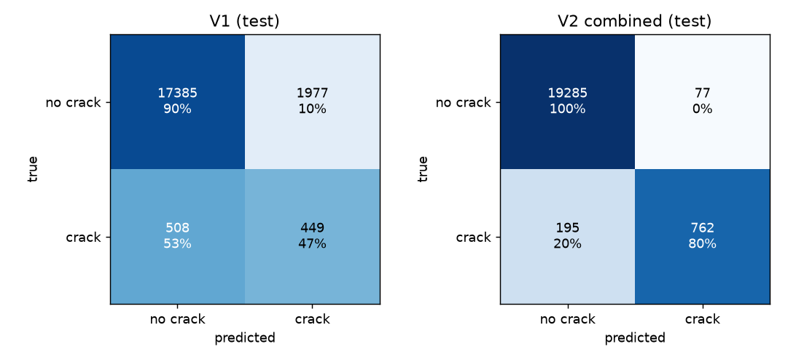
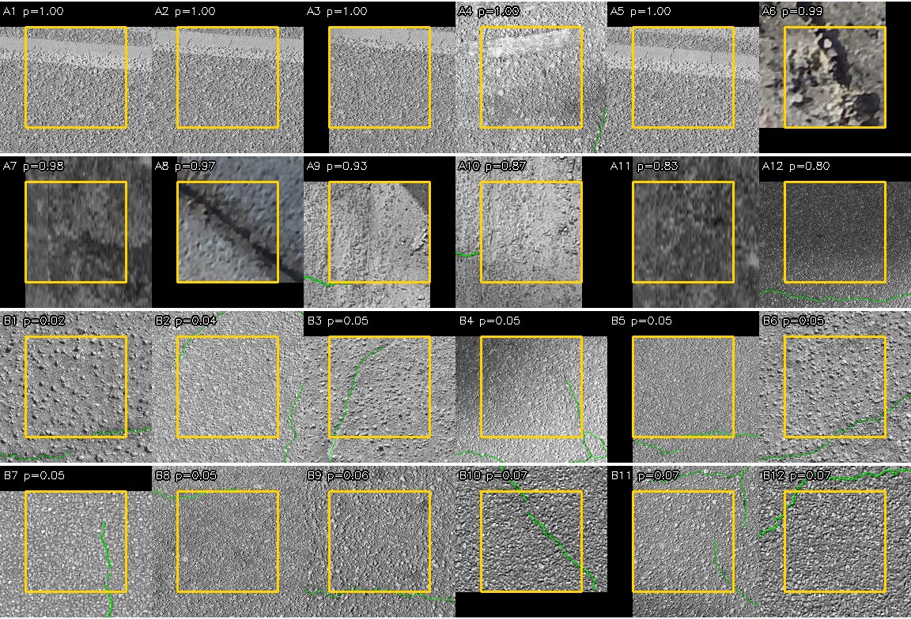
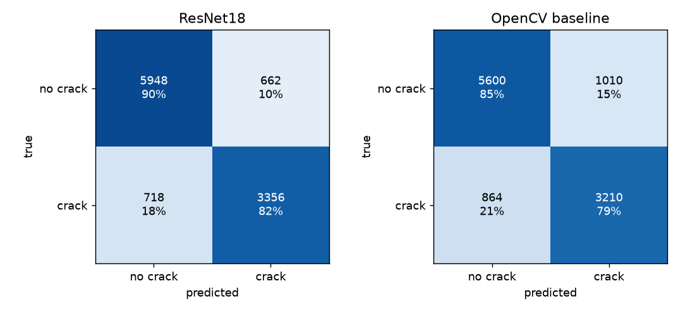
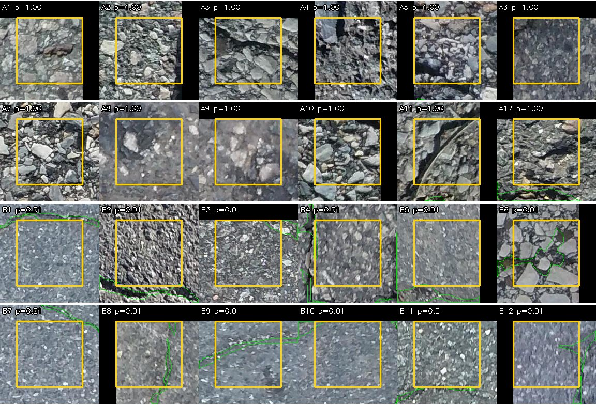
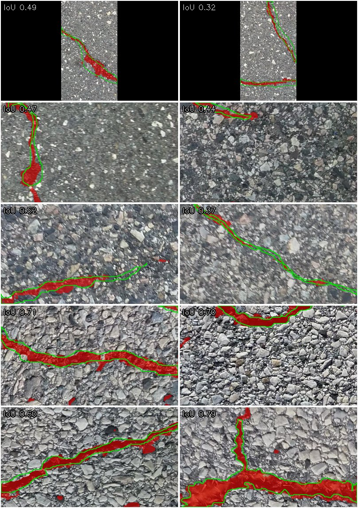

# RoadCrackQA

A Python pipeline for road crack images: check a large image set for data problems, then
detect cracks with PyTorch and write organized results.

## Results

### V2 tile classifier, on a new test set of four road datasets

The second version is trained on CRACK500 together with GAPS384, cracktree200, AEL, CFD and
SDNET2018 pavement patches (see [DATA.md](DATA.md)). It is compared with the first version
on a test set that neither model saw: 20319 labelled tiles of 128 px from AEL, GAPS384,
cracktree200 and SDNET2018, of which 957 are crack tiles. Each model uses the threshold it
chose on val, and the test set was scored once
([reports/test2_results.md](reports/test2_results.md)). The false alarm rate is the share of
no-crack tiles that are flagged.

| Method | Precision | Recall | F1 | PR-AUC | False alarm rate |
|---|---|---|---|---|---|
| V2 ResNet18, all datasets | 0.908 | 0.796 | **0.849** | 0.915 | **0.004** |
| V1 ResNet18, CRACK500 only | 0.185 | 0.469 | 0.265 | 0.191 | 0.102 |
| OpenCV baseline | 0.155 | 0.655 | 0.251 | 0.137 | 0.177 |

| Dataset | Tiles (crack) | V1 recall | V2 recall | V1 false alarm rate | V2 false alarm rate |
|---|---|---|---|---|---|
| AEL | 381 (99) | 0.414 | 0.778 | 0.018 | 0.021 |
| GAPS384 | 1665 (406) | 0.350 | 0.675 | 0.048 | 0.045 |
| cracktree200 | 1033 (452) | 0.588 | 0.909 | 0.007 | 0.010 |
| SDNET2018 | 17240 (0) | - | - | 0.111 | 0.001 |

- 95% bootstrap intervals over the 145 test source photos (2000 resamples within each
  dataset, the same draw for both models): V2 F1 0.823 to 0.871, V1 F1 0.199 to 0.363; V2
  minus V1 is 0.484 to 0.648 for F1, 0.285 to 0.369 for recall and -0.150 to -0.054 for the
  false alarm rate.
- Photo level, a photo is flagged when any of its tiles is: V2 flags all 125 test photos that
  hold a crack tile, and 2 of the 5 crack-free SDNET2018 photos (V1: 100 of 125, and 5 of 5).
- Where the gain comes from: V1 never saw these four datasets, so most of the difference is
  the training data. On val, using all CRACK500 tiles moved the false alarm rate at equal
  recall only from 0.079 to 0.062. Adding SDNET2018 no-crack tiles, half random and half the
  tiles an earlier model scored highest, brought it to 0.005. Adding the other road datasets
  cut false alarms on GAPS384 and raised recall on CFD and cracktree200. V2 combines both
  ([reports/ablation.md](reports/ablation.md)).
- SDNET2018 holds 89% of the no-crack test tiles, so the pooled false alarm rate mostly shows
  SDNET2018. On the other three datasets, V2's false alarm rate stays within 0.004 of V1's,
  while recall rises by 0.32 to 0.36. GAPS384 stays the hardest (F1 0.744).
- Training on CPU: 32439 tiles, head for 5 epochs, then `layer4` for 10 (best: epoch 9),
  86 min on a 20 thread laptop CPU ([reports/v2_train_combined.json](reports/v2_train_combined.json)).



The 12 most confident errors of each kind made by V2. GAPS384 tiles are left out because its
terms do not allow showing its images. A1 to A12 are false positives and B1 to B12 false
negatives; the scored tile is boxed in yellow, the labelled crack outlined in green:



- Four of the false positives (A1 to A3, A5) come from the top row of one cracktree200 photo,
  where a pale band meets the road surface. The others show dark lines, stains or edges, some
  right next to a labelled crack. A8 looks like a real crack in an SDNET2018 patch that is
  labelled crack-free.
- The false negatives are thin, faint cracks, mostly the one pixel wide cracks of
  cracktree200, often crossing only part of the tile.

### V1 tile classifier, CRACK500 test split

Tile level, CRACK500 test split: 10684 labelled tiles of 128 px, 38.1% crack, ambiguous tiles
excluded. Every threshold was chosen on val, and the test split was run once
([reports/test_results.md](reports/test_results.md)).

| Method | Precision | Recall | F1 | PR-AUC |
|---|---|---|---|---|
| ResNet18, ImageNet weights, fine-tuned | 0.835 | 0.824 | **0.829** | 0.918 |
| OpenCV baseline (black-hat, tuned on val) | 0.761 | 0.788 | 0.774 | 0.777 |
| Majority class (never flags) | 0.000 | 0.000 | 0.000 | - |

- Training on CPU: head on a frozen backbone for 5 epochs, then `layer4` for 6 more, on 8000
  of the 18941 train tiles; 876 s on a 20 thread laptop CPU (torch used 14 threads)
  ([reports/train_report.json](reports/train_report.json)). Val F1 0.861, train F1 0.906.
- Batch scoring of 200 full 2560 x 1440 photos (54752 tiles): 262 s on CPU, 0.76 photos per
  second ([reports/batch_summary.json](reports/batch_summary.json)); in the Docker image, 50
  photos at 0.78 per second ([reports/batch_summary_docker.json](reports/batch_summary_docker.json)).

### Error analysis

From the saved test predictions, no retuning ([reports/error_analysis.json](reports/error_analysis.json)).



- 95% bootstrap CI of test F1, resampling the 142 test source photos 2000 times:
  ResNet18 0.810 to 0.847, OpenCV baseline 0.750 to 0.796.
- Photo level: a crop is flagged when any tile reaches the threshold; 993 of 1087 test crops
  are flagged (recall 0.914). Every CRACK500 crop holds a crack, so a false alarm rate cannot
  be measured at this level.
- The 12 most confident errors of each kind, inspected by eye
  ([reports/error_candidates.csv](reports/error_candidates.csv)). A1 to A12 are false
  positives, B1 to B12 false negatives; the scored tile is boxed in yellow and the labelled
  crack is outlined in green:



| Cause | False positives | False negatives |
|---|---|---|
| Gravel texture, dark voids between stones | 6 | 0 |
| Stain or dark patch | 2 | 0 |
| Shadow | 1 | 0 |
| Joint or groove | 1 | 0 |
| Label: visible crack not in the mask, or mask in doubt | 2 | 1 |
| Labelled crack only grazes the tile border | 0 | 10 |
| Thin, faint crack | 0 | 1 |

  Most missed tiles hold 50 or more crack pixels only because the mask of a crack next door
  reaches over the border; a wider ambiguous band or labels from the crack centre line
  would treat them more fairly.

### Second dataset (CFD), no retraining

The same model and val thresholds on the 118 labelled CrackForest images (683 tiles, 442
crack) ([reports/cross_cfd.json](reports/cross_cfd.json)):

| Method | Precision | Recall | F1 | PR-AUC |
|---|---|---|---|---|
| ResNet18 | 1.000 | 0.534 | 0.696 | 0.972 |
| OpenCV baseline | 0.900 | 0.873 | 0.886 | 0.887 |

ResNet18 F1 drops from 0.829 to 0.696. Its ranking stays strong (PR-AUC 0.972) but the
threshold learnt on CRACK500 is too strict for CFD's thinner cracks, so recall falls. The
baseline's per image percentile rule happens to suit CFD, where every image holds a crack.
Photo level recall on CFD is 0.712.

### Pixel segmentation (SmallUNet)

Pixel level on the 1087 test crops (250.4 M pixels, 5.5% crack), pooled over all pixels;
the pixel threshold was chosen on val and the test split was run once
([reports/seg_test_results.json](reports/seg_test_results.json)).

| Method | IoU | F1 (Dice) | Precision | Recall |
|---|---|---|---|---|
| SmallUNet (1.94 M parameters) | **0.528** | 0.691 | 0.685 | 0.698 |
| OpenCV baseline mask | 0.249 | 0.399 | 0.575 | 0.306 |

- Trained from scratch on CPU with random 256 px crops, BCE plus Dice loss; best val epoch 8
  of 11 (early stopping), val IoU 0.636; 3787 s
  ([reports/seg_train_report.json](reports/seg_train_report.json)).
- `batch --mode seg` on 50 full photos: 0.51 photos per second on CPU, mean predicted crack
  pixel ratio 0.026 ([reports/batch_seg_summary.json](reports/batch_seg_summary.json)).
- Ten test crops picked with the seed, not by hand: predicted crack pixels in red, the
  labelled crack outlined in green, IoU per crop in the corner.



## Setup

Python 3.11. Install the CPU build of PyTorch first, then the package:

```bash
python -m venv .venv
source .venv/bin/activate          # Windows: .venv\Scripts\activate
pip install torch==2.14.1 torchvision==0.29.1 --index-url https://download.pytorch.org/whl/cpu
pip install -e ".[dev]"
```

Download the dataset by hand as described in [DATA.md](DATA.md).

## Data QA

```bash
crackqa qa --config configs/default.yaml
```

Writes `reports/qa_report.json` and `reports/qa_report.md` with:

- file inventory by split and extension
- corrupt files (zero bytes, or the image cannot be decoded)
- exact duplicates (SHA256) and near duplicates (dHash, Hamming distance 4 or less, under
  any rotation or flip), marked when a pair spans two splits
- image to mask pairing: missing masks, orphan masks, size mismatches
- masks that are not binary
- image size histogram and crack pixel ratio per split
- source photo ids per split and any id shared between splits
- what is left of the cross split findings after `data.exclude_sources`

On CRACK500 this found 8 photos stored in two official splits, rotated and sometimes
renamed; they are dropped from the later split (details in [DATA.md](DATA.md)).

```bash
crackqa qa-extra
```

Checks the other road datasets listed under `extra_data` (GAPS384, cracktree200, AEL, CFD
and the SDNET2018 pavement patches; see [DATA.md](DATA.md)) and writes
`reports/qa_extra.json` and `reports/qa_extra.md`: the same file, mask and source id checks
per dataset, labels from masks or from folders, source photos with no crack, and duplicates
against the CRACK500 crops and each other. A dHash candidate counts as a duplicate only when
the fine texture of the two aligned thumbnails also correlates, since plain road surfaces
under the same lighting share dHash bits without being the same picture. None of the 23806
candidates is a duplicate.

All settings live in `configs/default.yaml`.

## Tiles, split and baseline

```bash
crackqa tile        # data/processed/tiles.csv: every 128 px tile with its label
crackqa split       # per split manifests, reports/balance.md, reports/test_lock.txt
crackqa baseline    # OpenCV baseline, threshold tuned on val: reports/baseline_val.json
```

- A tile is **crack** with 50 or more crack pixels, **no crack** with none, and
  **ambiguous** in between. Ambiguous tiles are counted but left out of training and metrics.
- The split is the official one, checked by source photo: a test fails the run if any photo
  has tiles in two splits. The SHA256 of the test manifest is committed in
  `reports/test_lock.txt`.
- The classical baseline: CLAHE, blur, black-hat, a per image percentile threshold and small
  component removal, then the crack pixel ratio per tile. All of its settings and the tile
  threshold were chosen on val.

## Train, evaluate, score photos

```bash
crackqa train                       # reports/train_report.json, model in outputs/models/
crackqa eval --split val            # model vs baselines on val: reports/val_results.md
crackqa eval --split test --final   # once: reports/test_results.md, predictions_test.csv
crackqa batch --input PHOTOS --output OUT --include "*.jpg"
```

- `train` picks the epoch and the decision threshold by val F1; the ImageNet weights are
  downloaded by torchvision on first use.
- `eval --split test` only runs with `--final`, and refuses when the results already exist,
  the config differs from the one the model was trained with, the test manifest does not
  match `reports/test_lock.txt`, or the config or lock has uncommitted changes. It records
  the Git commit.
- `batch` writes `results.csv` (file, width, height, n_tiles, max_prob, mean_prob,
  crack_tile_ratio, flagged, status, model_version), one `overlays/*_overlay.jpg` per photo
  with tiles shaded by probability, `summary.json` with counts and runtime, and `batch.log`.
  A photo is flagged when any tile reaches the threshold. Corrupt files get
  `status=corrupt` and never stop the run.
- In tile mode, `batch` scores with the model in `paths.tile_model`, which is the V2 model
  in `outputs/v2/combined/` (train it with `crackqa v2-train --experiment combined`). With
  V2, all 200 full CRACK500 test photos are flagged, as they were with V1
  ([reports/batch_summary_v2.json](reports/batch_summary_v2.json)). Set `tile_model:
  outputs` to score with V1.

## Segmentation

```bash
crackqa seg-train                       # reports/seg_train_report.json, outputs/models/smallunet.*
crackqa seg-eval --split val            # SmallUNet vs OpenCV baseline mask on val pixels
crackqa seg-eval --split test --final   # once, behind the same lock and Git checks
crackqa batch --mode seg --input PHOTOS --output OUT --include "*.jpg"
```

In `seg` mode, `results.csv` holds file, width, height, crack_pixel_ratio, status and
model_version, with a mask PNG in `masks/` and an overlay in `overlays/` for each photo.

## Tiles over all datasets (V2)

```bash
crackqa v2-split                             # data/processed/v2/, reports/v2_balance.md, reports/test2_lock.txt
crackqa v2-eval --name "V1"                  # the V1 model on V2 val: reports/ablation.md
crackqa v2-train --experiment combined       # outputs/v2/combined/models/, reports/v2_train_combined.json
crackqa v2-eval --experiment combined        # its row in reports/ablation.md
crackqa v2-final --experiment combined --rehearse   # the final run's code on val, into outputs/v2/rehearsal/
crackqa v2-final --experiment combined       # once: reports/test2_results.md, predictions_test2.csv
```

- `v2-split` tiles CRACK500 and every dataset under `v2.datasets` into one table, leaving the
  files above (`tiles.csv`, `manifest_*.csv`, `test_lock.txt`) as they are. CRACK500 keeps its
  official train and val, and its test crops stay out. The other datasets are split 60/20/20
  (CFD 80/20, train and val only) by groups of source photos: consecutive ids form one
  group, so neighbouring stretches of one road never end up in two splits. SDNET2018 photos
  with no crack go to test.
- Labels come from the centre line of the mask (Zhang-Suen thinning): a tile is **crack**
  with at least 32 pixels of centre line, **no crack** with no mask pixel, and **ambiguous**
  otherwise. Unlike a count of mask pixels, this does not depend on how wide a dataset draws
  a crack (one pixel in cracktree200, about six in CRACK500), and a wide mask that only
  reaches over the border no longer makes a crack tile. SDNET2018 patches carry one label per
  256 px patch, so a no-crack patch gives four no-crack tiles and a crack patch four ambiguous
  ones.
- The split is checked for any source photo or group in two splits, and the SHA256 of the
  test manifest is committed in `reports/test2_lock.txt`.
- `v2-eval` scores only val, per dataset and pooled, with the false alarm rate on no-crack
  tiles, and keeps one row per `--name` in `reports/ablation.json` and `reports/ablation.md`.
  Its summary also compares every model at the threshold where it reaches V1's pooled recall.
- `v2-train` runs one entry of `v2_train.experiments`: which datasets, an optional cap on
  tiles, how many `layer4` epochs, and SDNET2018 no-crack tiles added at random or mined with
  another experiment's model. Epoch and threshold are picked on val, at most 4000 tiles per
  dataset.
- `v2-final` scores V1 and the chosen experiment on the V2 test tiles in one run, with
  bootstrap intervals by source photo, photo level flags and two figures. It refuses when
  results exist, when the config differs from the one the V2 model was trained with, when
  the test manifest does not match `reports/test2_lock.txt`, when either model file is not
  the one on record, or when the config, lock or training report has uncommitted changes.

## Analysis and Docker

```bash
crackqa analyze        # bootstrap CI, confusion figure, worst error grid from the saved test run
crackqa cross          # the frozen model on CFD (paths in cross_dataset)
crackqa seg-examples   # reports/figures/seg_examples.jpg, only after the final seg run
```

Causes of the worst errors are filled in by hand in `reports/error_candidates.csv` and kept
when `analyze` runs again.

```bash
docker build -t roadcrackqa .
```

PowerShell:

```powershell
docker run --rm -v "${PWD}\outputs:/app/outputs" -v "${PWD}\data:/app/data" roadcrackqa batch --input data/raw/CRACK500/valdata --output outputs/batch_docker --include "*.jpg"
```

Git Bash on Windows:

```bash
MSYS_NO_PATHCONV=1 docker run --rm -v "$(pwd -W)/outputs:/app/outputs" -v "$(pwd -W)/data:/app/data" roadcrackqa batch --input data/raw/CRACK500/valdata --output outputs/batch_docker --include "*.jpg"
```

On Linux or macOS, mount `$PWD/outputs` and `$PWD/data` the same way. The trained models
are read from the mounted `outputs/` (tile mode: `outputs/v2/combined/models/`, seg mode:
`outputs/models/`), never baked into the image.

## Reproduce

```bash
crackqa qa && crackqa tile && crackqa split && crackqa baseline
crackqa train && crackqa eval --split val
crackqa seg-train && crackqa seg-eval --split val
```

The test lock and the config must be committed before either `--final` run. After the
final runs, `crackqa analyze` and `crackqa cross` read the saved results.

V2, after `crackqa qa-extra` and with the V1 model trained:

```bash
crackqa v2-split
for e in v1_recipe all_tiles sdnet_negatives mixed_sources combined; do
  crackqa v2-train --experiment $e && crackqa v2-eval --experiment $e
done
```

`sdnet_negatives` mines with the `all_tiles` model and `combined` with the `mixed_sources`
model, so this order matters. Together the five runs took about 5 hours on the laptop CPU.

## Tests

```bash
ruff check .
pytest -q
```

Tests build synthetic images in a temporary folder, so they need no dataset.

## Limitations

CRACK500 holds RGB phone photos. Survey systems such as laser crack measurement produce 3D
range and intensity images, so this project shows the method, not a model ready for that data.

The baseline's percentile threshold assumes each image holds a crack, which is true for the
CRACK500 crops (they were cut around cracks) but not for arbitrary photos.

The models expect road surface photos. They answer only crack or no crack and cannot say
that an image is not a road. On five ordinary desktop wallpapers (landscapes and abstract
art), `batch` in tile mode flagged four with V1 and two with V2. V2 marked a tree line,
grass and grainy surfaces as cracks, with scores up to 0.99. Plain grey, white and noise
images are flagged by neither. A dark line drawn on a plain grain texture is flagged by V1
(1.00) but not by V2 (0.45, threshold 0.53), so a crack-like line on unusual texture can now
be missed. The scores per image are in [reports/batch_notroad_v1.csv](reports/batch_notroad_v1.csv) and
[reports/batch_notroad_v2.csv](reports/batch_notroad_v2.csv). On real road tiles without a
crack, the false alarm rate is 10% for V1 on the CRACK500 test (662 of 6610 tiles) and 0.4%
for V2 on the V2 test (77 of 19362).

The V2 test set has no CRACK500 or CFD tiles: both were already used to test V1, and their
errors shaped V2, so CRACK500's test crops stay out and CFD is used only for training and
val. Most of its no-crack tiles are SDNET2018 patches, whose
labels cover a whole 256 px patch, and at least one of the patches labelled crack-free shows
a crack. The test set holds 145 source photos, and only 5 of them are crack-free, so the
photo level false alarm rate rests on 5 photos.

## License

Code: MIT, see [LICENSE](LICENSE). Datasets keep their own terms, see [DATA.md](DATA.md).
